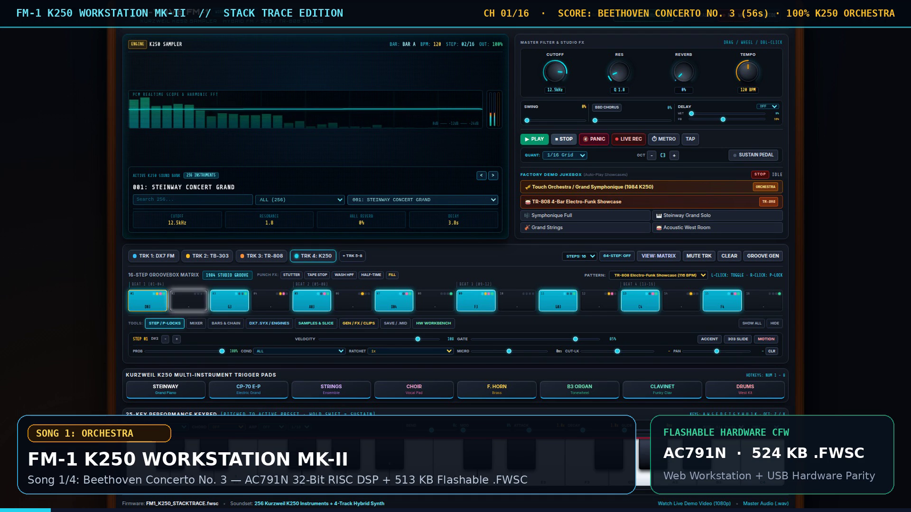
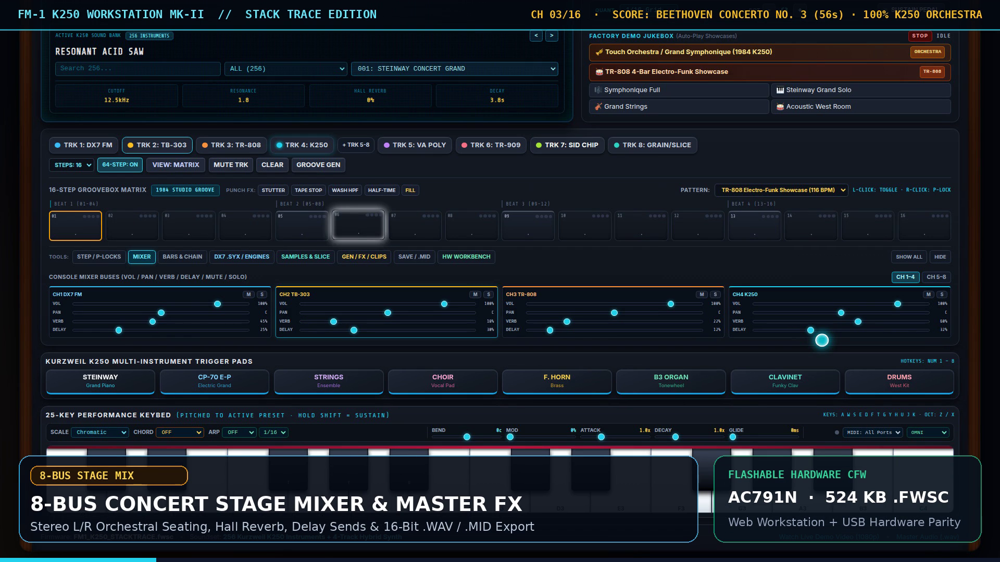
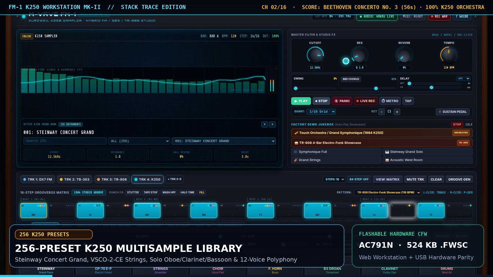
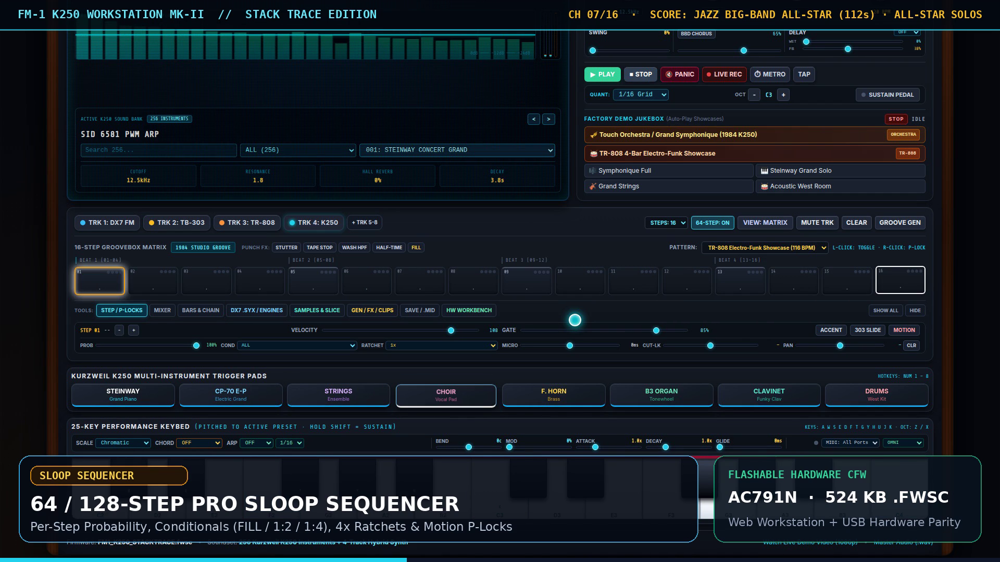
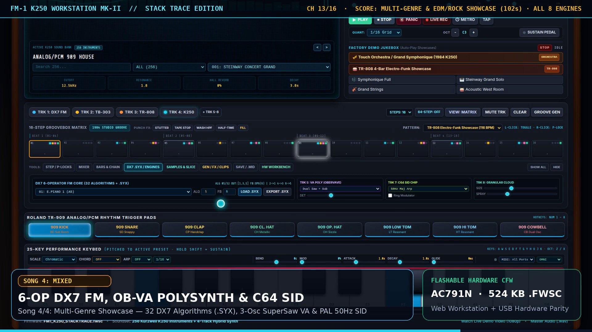
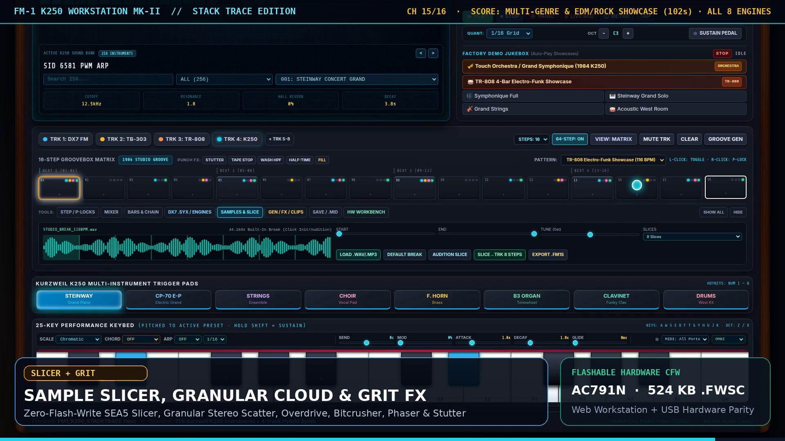

# FM-1 Stack Trace CFW (Custom Firmware + 256-Preset Web Workstation)

**Open-source Custom Firmware (`FM1_K250_STACKTRACE.fwsc`) for the M-VAVE FM-1 Groovebox / Synthesizer**, built on FM1 Open V14 with 4 new Q23 fixed-point DSP synthesis engines, a 128-step Pro Sequencer, Euclidean & 303 Acid generators, an 8-scene clip launcher, live Grit & Punch FX, a zero-flash-write sample slicer, MIDI CC Learn, 5 built-in MIDI-driven showcase demos, and a standalone 256-preset browser workstation.

> **Safety First:** Always back up your Projects, Samples, and DX7 Voice Banks via the [M-VAVE FM-1 Workbench](https://open.m-vave.com/fm1-workbench) before flashing any custom firmware. You can return to stock V15 at any time using the official Workbench.

---

## What's New in Stack Trace CFW

| Area | Features Added |
| :--- | :--- |
| **4 Extra Live DSP Engines** (`cfw_dsp.c`) | **VA Poly** (dual-DCO SuperSaw + resonant SVF), **TR-909** (punchy analog/PCM hybrid kit), **C64 SID** (6581 chiptune arpeggiator & pulse/tri), **Granular** (real-time stereo scatter cloud), alongside Stock DX7 / 808 / Sampler |
| **128-Step Pro Sequencer** (`cfw_seq.c`) | Bank A (`1–64`) & Bank B (`65–128`), per-step **Probability** (`12%–100%`), **Conditionals** (`1:2`, `2:2`, `1:4`, `4:4`, `FILL`, `!FILL`, `1ST`), **1×–4× Ratchets**, and stopped step-time chord capture |
| **Algorithmic Generators** | **Euclidean Rhythm** generator (pulses / steps / rotation) & **303 Acid Pattern** generator (root, scale lock, density, seed) |
| **8-Scene Clip Launcher** | Snapshot & launch 8 scenes storing mute masks, Bank A/B state, per-track engines, pattern lengths, and tempo |
| **Grit & Punch Live FX** | **Overdrive**, **Bitcrusher**, **4-Stage Phaser**, **Sidechain Pump**, plus **Punch FX** (`STUTTER`, `TAPE STOP`, `WASH HPF`, `HALF-TIME`, `BIT SCATTER`) and `FILL` hold |
| **Zero-Flash-Write Slicer** | Slice any of the 8 flash sample slots into 2, 4, or 8 pads with custom start/end % — **no flash wear** |
| **MIDI CC Learn & USB Audio** | Map external MIDI CCs to Cutoff, Reso, Decay, Morph, Drive, Crush, Phaser, Sidechain, Punch FX, Fill, and USB Monitor; live USB Audio RX/TX telemetry |
| **5 Built-In Showcase Demos** | **Beethoven Orchestra (56s)**, **Jazz Big-Band All-Star (112s)**, **Stars & Stripes March (87s)**, **Multi-Genre & EDM/Rock Showcase (102s)**, and **20th Century Fanfare (23s)** — stored as compact LZ77-packed MIDI streams (`9.0 KB` total, zero embedded WAVs) |
| **256-Preset Web Workstation** | Standalone `FM1_Web_Workstation.html` (on GitHub Releases) with 675 calibrated multi-samples, studio amp/cabinet IR DSP, 8-bus mixer, and `.WAV` / `.MID` export (plus FM-1 Workbench sources in [`web/`](web/)) |

---

## Flashing Guide (M-VAVE FM-1 Hardware)

1. **Back Up Your Synth**
   - Connect your FM-1 via USB and open the [M-VAVE FM-1 Workbench](https://open.m-vave.com/fm1-workbench).
   - Export your **Projects**, **Sample Bank**, and **DX7 Voice Banks A–D**.
2. **Download & Verify the Firmware**
   - Download `FM1_K250_STACKTRACE.fwsc` and `SHA256SUMS.txt` from the [GitHub Releases](../../releases) page.
   - Verify the SHA-256 checksum (`sha256sum -c SHA256SUMS.txt`).
3. **Flash via Workbench**
   - Select **Firmware Update -> Local File** in the Workbench and choose `FM1_K250_STACKTRACE.fwsc`.
   - Keep the FM-1 powered on and USB connected until the reboot splash screen (`STACK TRACE PRESENTS // K250 SIMULATOR`) appears.
4. **Rolling Back to Stock**
   - Use the M-VAVE Workbench firmware restore option to flash official V14/V15 at any time, then restore your exported backups.

---

## Quick-Start Hardware Controls

- **CFW Engines & Sound Params:** On track view, select between `STOCK`, `VA POLY`, `TR-909`, `C64 SID`, and `GRANULAR`, and tweak the 4 Q23 engine parameters (`0–100`).
- **128-Step Sequencer (Bank A/B):** Toggle Bank A (`1–64`) / Bank B (`65–128`) and edit per-step **Prob**, **Cond**, and **Ratchet (1×–4×)**.
- **Demo Jukebox:** Open the **DEMO SONGS** bank (`preset_bank == 2`) from the preset/project browser to audition all 5 built-in MIDI showcase tracks directly on the hardware DSP.
- **Zero-Wear Slicer:** Select a flash sample slot (`0–7`), set `2 / 4 / 8` slices and Start/End %, then apply to map slices across pads without writing to Flash.

---

## Walkthrough Video & UI Screenshots

### Full 5m 59s Feature Walkthrough (All 4 Approved Demo Songs)

https://github.com/jonludwig1234/fm1-stacktrace-cfw/releases/download/v1.0.0-stacktrace/FM1_K250_STACKTRACE_YOUTUBE_16x9.mp4

[](https://github.com/jonludwig1234/fm1-stacktrace-cfw/releases/download/v1.0.0-stacktrace/FM1_K250_STACKTRACE_YOUTUBE_16x9.mp4)

### Workstation & CFW Screenshots

| Workstation & 256-Preset Library | 8-Bus Concert Stage Mixer |
| :---: | :---: |
|  |  |
| **256 Presets & Live Keybed** | **128-Step Pro SLOOP Sequencer** |
|  |  |
| **DX7 / VA Poly / C64 SID Engines** | **Sample Slicer, Granular & Grit FX** |
|  |  |

---

## Demo Songs & Walkthrough Videos

All 5 mastered demo songs and both showcase videos are included directly in [`demos/`](demos/) and on the [Releases](../../releases/tag/v1.0.0-stacktrace) page:

- [`demos/FM1_K250_STACKTRACE_YOUTUBE_16x9.mp4`](demos/FM1_K250_STACKTRACE_YOUTUBE_16x9.mp4) — Full 5m 59s 16:9 feature walkthrough covering all 4 demo songs
- [`demos/FM1_K250_STACKTRACE_SHORT_9x16.mp4`](demos/FM1_K250_STACKTRACE_SHORT_9x16.mp4) — 56s 9:16 vertical showcase
- [`demos/FM1_K250_SONG1_ORCHESTRA_56s.wav`](demos/FM1_K250_SONG1_ORCHESTRA_56s.wav) — Beethoven Concerto No. 3 Orchestra (56s)
- [`demos/FM1_K250_SONG2_JAZZ_112s.wav`](demos/FM1_K250_SONG2_JAZZ_112s.wav) — Jazz Big-Band All-Star (112s)
- [`demos/FM1_K250_SONG3_MARCH_87s.wav`](demos/FM1_K250_SONG3_MARCH_87s.wav) — Stars & Stripes Forever March (87s)
- [`demos/FM1_K250_SONG4_MIXED_102s.wav`](demos/FM1_K250_SONG4_MIXED_102s.wav) — Multi-Genre & EDM/Rock Showcase (102s)
- [`demos/FM1_K250_SONG5_FOX_FANFARE_23s.wav`](demos/FM1_K250_SONG5_FOX_FANFARE_23s.wav) — 20th Century Fanfare (Bb Major Orchestral, 23s)
- [`demos/20th_Century_Fox_Fanfare.mid`](demos/20th_Century_Fox_Fanfare.mid) — Standard MIDI File (SMF Type 1, 114 BPM)

---

## Standalone Web Workstation

Download `FM1_Web_Workstation.html` from [GitHub Releases](../../releases) and open it in any modern Chromium/Firefox/Safari browser (no server or install required), or build the FM-1 browser workbench from [`web/`](web/) via `build.bat --web`, to:
- Audition all **256 workstation presets** across 8 synthesis/sampling engines.
- Play all **5 Showcase Demo Songs** live through the 8-bus mixer and record lossless 16-bit `.WAV` masters.
- Sync with physical FM-1 hardware over WebMIDI (`0xF8` clock & DX7 `.SYX` transfer).

---

## Building from Source

Firmware builds target the **AC791N (PI32v2 `r3`)** using the JieLi 2.5.3 toolchain (`clang.exe`, `pi32v2-ld.exe`, `llvm-objcopy.exe`).

- Windows PowerShell (official SDK flow):
  ```powershell
  $env:FM1_PI32_TOOLCHAIN = 'C:\JL\pi32'
  .\sdk\Build.ps1 -FirmwareOnly -Toolchain 'C:\JL\pi32'
  ```
- Linux (via Wine + Python packager; set `FM1_PI32_TOOLCHAIN` to your JieLi PI32v2 directory):
  1. Generate compact Flash assets (`cfw_demo_songs.h`, `stacktrace_avatar_rle.h`): `python3 tools/gen_firmware_assets.py`
  2. Compile & link `sdk.elf`: `FM1_PI32_TOOLCHAIN=/path/to/jieli_pi32 python3 tools/build_firmware.py`
  3. Package `FM1_OFFICIAL_OPEN.fwsc`: `FM1_PI32_TOOLCHAIN=/path/to/jieli_pi32 python3 tools/package_fw.py`
  4. Verify ELF/ISR/Container integrity (`7/7 PASS`): `FM1_PI32_TOOLCHAIN=/path/to/jieli_pi32 python3 tools/verify_firmware_suite.py`
- Host-side storage fault-injection & unit tests (Linux/macOS with `gcc`):
  ```bash
  gcc -std=c11 -Wall -Wextra -Werror -fsanitize=address,undefined -Iapp -Iapp/synth -Isdk/include tests/test_storage_faults.c app/project.c app/fm_library.c -o /tmp/test_storage_faults && /tmp/test_storage_faults
  gcc -std=c11 -Wall -Wextra -Werror -fsanitize=address,undefined -Iapp -Iapp/synth -Isdk/include tests/test_cfw_fixes.c app/presets.c app/samples.c -o /tmp/test_cfw_fixes && /tmp/test_cfw_fixes
  ```

---

## License & Attribution

- **Application Firmware (`app/`):** [GPLv3 with the FM1 SDK linking exception](LICENSE.md).
- **Device Engine SDK (`sdk/`):** Binary SDK provided under separate terms; retain [THIRD_PARTY.md](THIRD_PARTY.md) when distributing builds.
- Built on [m-vave/fm1_open](https://github.com/m-vave/fm1_open).
